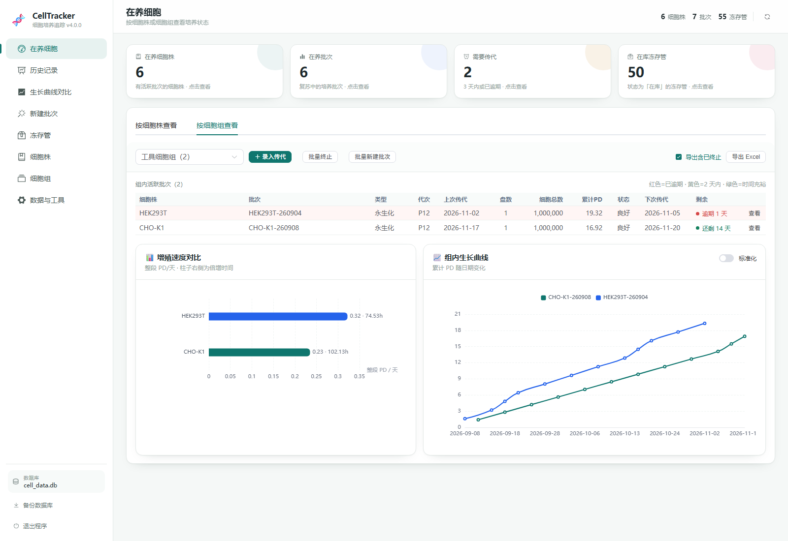
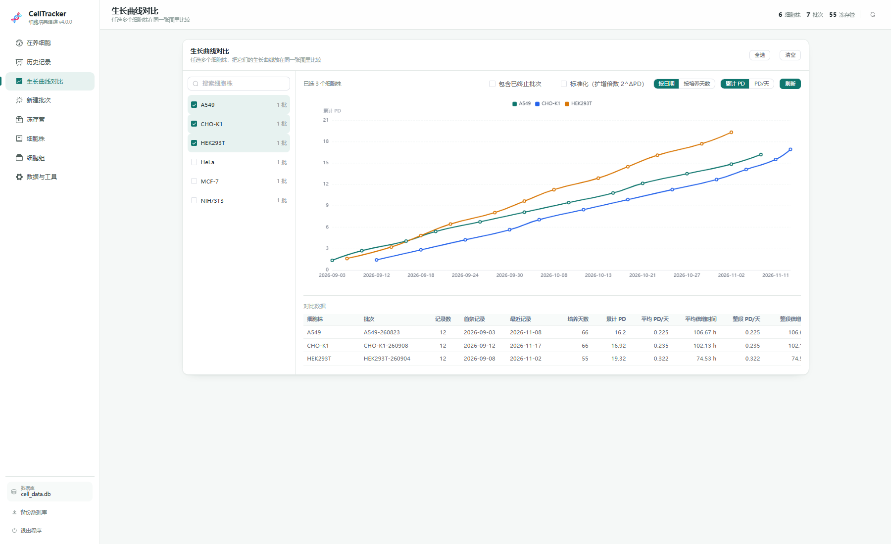
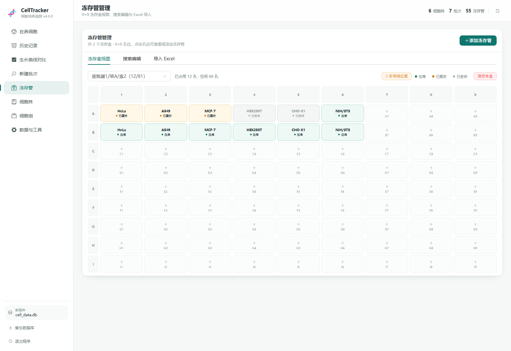

# 🧬 CellTracker · 细胞培养追踪

记录细胞株、培养批次、传代、冻存和生长曲线。Windows / macOS 解压即用，无需安装 Python 或 Node.js。

## 界面预览

## 下载

从 GitHub Releases 下载对应压缩包：

- **Windows 64 位**：`CellTracker-4.0.0-win64.zip`
- **macOS 通用版**：`CellTracker-4.0.0-macos-universal.zip`（Intel + Apple Silicon）

## Windows

1. 解压到有写权限的目录，例如 `D:\CellTracker` 或桌面，不要放在 `C:\Program Files`。
2. 双击 `CellTracker.exe`。
3. 浏览器打开 <http://127.0.0.1:18600/>；没有自动打开时手动访问即可。
4. 数据保存在程序旁的 `data\cell_data.db`。关闭黑色控制台窗口，或在页面左下角点「退出程序」即可停止。

首次运行若提示“Windows 已保护你的电脑”，点 **更多信息 → 仍要运行**。

## macOS

1. 解压后把 `CellTracker.app` 拖到“应用程序”或任意文件夹。
2. 第一次打开：右键点击 App → **打开**；若提示“无法验证开发者”，再点一次 **打开**。
3. 浏览器打开 <http://127.0.0.1:18600/>；没有自动打开时手动访问即可。
4. 数据保存在 `~/Library/Application Support/CellTracker/`。

退出：在页面左下角点击「退出程序」。也可以在“活动监视器”中结束 `CellTracker`，或在终端执行 `pkill CellTracker`。

## 更新软件

- **Windows**：下载新版本，解压后只替换 `CellTracker.exe`，保留 `data` 和 `backups` 文件夹。
- **macOS**：用新的 `CellTracker.app` 替换旧 App，数据在 `~/Library/Application Support/CellTracker/`，不会被删除。
- 更新前可以点页面左下角「备份数据库」，把 `.db` 下载到“下载”文件夹；需要时在「数据与工具 → 恢复备份」上传恢复。
