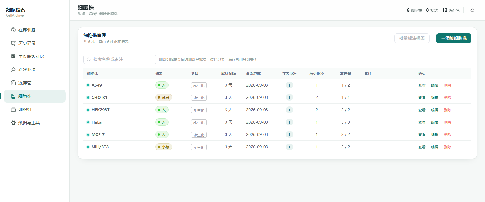

# 细胞档案 CellArchive

**细胞培养管理追踪工具** —— 记录细胞株、培养批次、传代、冻存和生长曲线，自动计算 PD 值与倍增时间。本地运行，数据只存在你自己的电脑上。


> 预览图使用演示数据，细胞株为通用的 HEK293T / CHO-K1 / A549 等。

---

## 这是什么

养细胞通常靠 Excel 记录：第几代、哪天传的、种了几盘、收了多少、PD 涨了多少、冻了几管放在哪个盒子。表格一多就容易乱——PD 算错、忘了上次传代是哪天、冻存管找不到、想比较两株细胞长得快慢只能手动画图。

细胞档案把这些收进一个本地网页应用。

## 功能

### 在养细胞

按**细胞株**或**细胞组**查看培养状态。首页四张卡片一眼掌握全局：

| 卡片 | 内容 |
| --- | --- |
| 在养细胞株 | 有活跃批次的细胞株数量 |
| 在养批次 | 复苏中的培养批次数量 |
| 需要传代 | 3 天内到期或已逾期的批次（红=逾期，黄=2 天内，绿=时间充裕） |
| 待录入位置 | 在库但还没填孔位的冻存管，点进去直接补 |

### 传代记录

录入收获细胞数与接种细胞数，自动计算：

- **单次 PD** = log₂(收获数 ÷ 上次接种数)
- **累计 PD** = 初始 PD + Σ 单次 PD（负增长不累加）
- **PD/天** = 单次 PD ÷ 间隔天数
- **倍增时间** = 24 ÷ PD/天

代次、盘数、每盘细胞数、下次传代日期都可一并记录。

### 生长曲线

累计 PD 随日期变化的折线图。支持两种模式：

- **原始累计 PD**：直接看每个批次的增长轨迹
- **标准化（2^ΔPD）**：以指定日期为基准换算成扩增倍数，用对数轴比较不同起点的批次

### 生长曲线对比

从所有细胞株里任选多株，放到同一张图里比较。可以按日期或按培养天数对齐，下方自动生成汇总表（记录数、培养天数、累计 PD、平均/整段 PD 与倍增时间）。


### 冻存管理

- **9×9 冻存盒视图**：俯视整个盒子，点空孔位直接录入，点已有孔位查看详情
- **搜索编辑**：按细胞名/位置/备注搜索，整行点击即可编辑
- **Excel 批量导入**：每个 Sheet 代表一个盒子，A1:I9 区域填细胞名、细胞数、PD、日期等
- 位置留空的管会被标记为「待录入位置」，在页头和首页卡片提醒


### 自定义标签与配色

细胞株的**标签**是自由文本，不预设任何选项——填物种、细胞类型、项目代号、来源都可以。

配色规则：

- **同一标签 → 同一色系**：标签相同的细胞株在图表里用相近色相，一眼看出属于一组
- **不同标签 → 明显区分**：每个标签独占一段色相区间，不会撞色
- **颜色只由标签名决定**：新增或改名标签不会让已有标签变色，刷新页面也不变
- 不填标签的细胞株统一用中性灰

可以在「细胞株」页面逐个编辑，也可以点「批量标注标签」一次性给多株填写。



### 数据安全

- SQLite 单文件存储，整个数据库就是一个 `.db` 文件
- 页面左下角「备份数据库」一键下载快照，「数据与工具 → 恢复备份」上传恢复
- 兼容旧版 Streamlit 应用的数据结构，旧库直接可用
- 程序只监听本机 `127.0.0.1`，不向任何服务器发送数据

---

## 安装与使用

### 方式一：Windows 一键版（推荐）

**不需要安装 Python，也不需要安装 Node.js。**

**第 1 步** 下载最新版：[Releases](https://github.com/umlla/CellArchive/releases/latest) → 下载 `CellArchive-4.0.0-win64.zip`

**第 2 步** 解压到一个**有写入权限**的文件夹，例如 `D:\CellArchive` 或桌面

> ⚠️ 不要解压到 `C:\Program Files`，程序需要在同目录下创建数据文件

**第 3 步** 双击 **`CellArchive.exe`**

**第 4 步** 浏览器会自动打开；若没有自动打开，手动访问 <http://127.0.0.1:18600/>

首次运行如果弹出「Windows 已保护你的电脑」，点 **更多信息 → 仍要运行**（这是 Windows 对未签名程序的通用提示，不影响使用）。

#### 日常使用

| 事项 | 做法 |
| --- | --- |
| 启动 | 双击 `CellArchive.exe` |
| 关闭 | 关掉黑色命令行窗口，或页面左下角点「退出程序」 |
| 数据位置 | 程序目录下的 `data\cell_data.db` |
| 备份 | 拷走整个 `data` 文件夹，或点页面左下角「备份数据库」 |
| 更新 | 下载新版 zip，只替换 `CellArchive.exe`，保留 `data` 和 `backups` |
| 换电脑 | 把整个文件夹拷过去 |

### 方式二：从源码运行

需要 **Python 3.10+** 和 **Node.js 18+**（Node 只在首次构建前端时需要）。

#### Windows

双击 **`start.bat`**。它会自动：创建虚拟环境 → 安装依赖 → 构建前端页面 → 启动服务。

首次运行需要几分钟且需要联网，之后每次直接启动。

#### 手动步骤

```bash
git clone https://github.com/umlla/CellArchive.git
cd CellArchive

python -m venv .venv
.venv\Scripts\activate            # macOS/Linux: source .venv/bin/activate
pip install -r backend/requirements.txt

cd frontend && npm install && npm run build && cd ..

python -m backend.serve
```

然后打开 <http://127.0.0.1:18600/>。

> `frontend/dist` 是构建产物、不进版本库，所以首次运行需要 Node.js 生成页面。装过一次以后就不再需要它。

---

## 配置（可选）

程序默认就能用，**不需要任何配置**。只有需要改端口、开放局域网、开启登录时才需要建配置文件。

复制 `config.example.json` 为 `config.json`，按需修改：

| 字段 | 说明 |
| --- | --- |
| `host` | 监听地址。`127.0.0.1` 只有本机能访问；改成 `0.0.0.0` 后同一局域网的其他设备也能访问 |
| `port` | 端口，默认 18600。若提示端口被占用，改成 18601 等 |
| `database` | 数据库文件位置，默认 `data/cell_data.db` |
| `auth.enabled` | 是否启用登录认证，默认关闭 |

> `config.json` 里有你自己的设置，不会被提交到仓库。

---

## 数据迁移

旧版应用的数据库可直接使用：把旧的 `.db` 放到 `data/cell_data.db`（或改 `config.json` 的 `database`）后启动即可。

表结构完全兼容，启动时会自动补齐新增字段。迁移前建议先备份旧库。

> Go 版（exe）和源码版打开同一个数据库时，颜色完全一致，可以随时互换。

---

## 开发

### 修改前端

```bash
cd frontend
npm install
npm run dev      # 开发模式，改代码自动刷新
npm run build    # 构建到 frontend/dist，由后端托管
```

### 运行测试

```bash
pytest           # Python 后端测试
go test ./...    # Go 版测试
```

### 构建 Windows 一键版

需要 Go 1.26+（放在 PATH 里，或解压到 `.tools\go`）：

```powershell
.\build.ps1 -Frontend     # 构建前端 + 打包 exe 到 release\
.\build.ps1               # 只重新打包（前端已构建过）
```

### 技术栈

- **后端**：Flask 3 + waitress（Python）／ Go 单文件版（用于打包 exe）
- **前端**：Vue 3 + Vite + Element Plus + ECharts
- **存储**：SQLite 单文件

---

## 常见问题

<details>
<summary><b>exe 版提示「Windows 已保护你的电脑」</b></summary>

点「更多信息 → 仍要运行」。这是 Windows 对未签名程序的通用提示。
</details>

<details>
<summary><b>源码版提示「未找到 Python 3.10 或更高版本」</b></summary>

Python 没装好或版本太旧。重装时记得勾选 **Add python.exe to PATH**。
</details>

<details>
<summary><b>源码版提示「未找到 Node.js / npm」</b></summary>

还没装 Node.js，去 <https://nodejs.org/> 下载 LTS 版本后重新双击 `start.bat`。
</details>

<details>
<summary><b>提示端口已被占用</b></summary>

改 `config.json` 的 `port`（例如改成 18601），或关掉占用该端口的程序。
</details>

<details>
<summary><b>页面打不开</b></summary>

确认那个黑色命令行窗口还开着——窗口一关服务就停了。
</details>

<details>
<summary><b>数据会不会传到网上</b></summary>

不会。程序只在本机运行，监听 `127.0.0.1`，不向任何服务器发送数据。除非你把 `host` 改成 `0.0.0.0` 主动开放局域网访问。
</details>

<details>
<summary><b>多个批次同时养着，PD 会混吗</b></summary>

不会。PD 按批次独立计算，每个批次有自己的累计 PD。同一细胞株的多个批次在图表里用同色系不同深浅区分。
</details>

---

## 许可

见 [LICENSE](LICENSE)。
