# 细胞档案 CellArchive

**细胞培养与实验管理工具** —— 记录细胞株、培养批次、传代、冻存、生长曲线，并管理细胞实验日程、待办与课题讨论。本地运行，数据只存在你自己的电脑上。

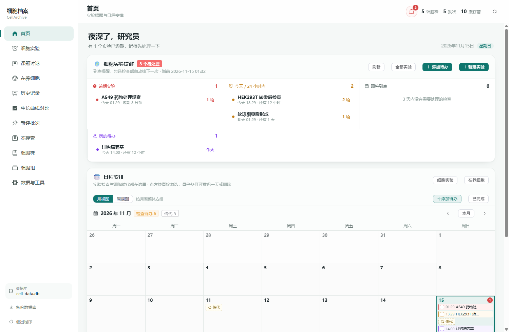

> 以上截图使用演示数据，细胞株为通用的 HEK293T / CHO-K1 / A549 / HeLa / NIH-3T3。

---

## 功能

| 板块 | 用途 |
| --- | --- |
| 首页 | 实验提醒 + 月/周视图日程，今天要处理什么一目了然 |
| 细胞实验 | 实验日程与检查提醒，勾选后自动排下一次 |
| 课题讨论 | 按课题记录与导师的讨论，支持 Markdown |
| 在养细胞 | 按细胞株或细胞组查看培养状态 |
| 历史记录 | 查看和编辑所有传代记录 |
| 生长曲线对比 | 多株细胞放在一起比 |
| 冻存管 | 9×9 冻存盒视图与 Excel 导入 |
| 细胞株 / 细胞组 | 管理细胞株，按组归类 |
| 数据与工具 | 备份、恢复、数据体检 |

---

## 安装（源码部署）

需要 **Python 3.10+** 和 **Node.js 18+**。Node 只在第一次构建页面时用到。

### 1. 装两个软件

| 软件 | 下载 | 注意 |
| --- | --- | --- |
| Python 3.10+ | <https://www.python.org/downloads/> | Windows 安装时**勾选 Add python.exe to PATH** |
| Node.js 18+ | <https://nodejs.org/zh-cn> | 选 **LTS** 版本 |

装完**关掉所有命令行窗口再重新打开**。

### 2. 下载代码

```bash
git clone https://github.com/umlla/CellArchive.git
cd CellArchive
```

> 没有 git 也行：在网页上点 **Code → Download ZIP**，解压后进入文件夹。

### 3. 双击启动

**Windows** → 双击 **`start.bat`**
**Mac** → 双击 **`start.command`**

脚本会自动装依赖、构建页面、启动服务。第一次约 3-8 分钟（需要联网），之后几秒就好。

> **Mac 第一次打开被拦住了怎么办**
>
> Mac 会提示「无法打开，因为它来自身份不明的开发者」。
>
> 解决办法：**右键点** `start.command` → 选 **打开**，弹窗里再点一次**打开**。
>
> Mac 的右键是**双指同时点按触控板**，或按住 **Control** 键再点。
>
> 如果右键菜单里没有「打开」，在终端执行一次 `chmod +x start.command`，之后双击即可。

### 4. 在浏览器里打开

看到下面这行提示后，**手动用浏览器访问**：

```
 请在浏览器中打开：http://127.0.0.1:18600/
```

程序不会自动弹浏览器。使用期间保持那个命令行窗口开着，关掉就是退出。

### 5. 日常使用

| 事项 | 做法 |
| --- | --- |
| 启动 | 双击 `start.bat` / `start.command` |
| 关闭 | 关掉命令行窗口，或点页面左下角「退出程序」 |
| 备份 | 点页面左下角「备份数据库」 |
| 更新 | 在项目目录执行 `git pull`，重新启动 |

---

## 操作指南

### 首页

顶部是**实验提醒栏**：逾期实验、今天 / 24 小时内、即将到点、我的待办。点任意一条直接跳到对应位置。

下方是**日程安排**，可切换月视图和周视图。

**月视图**——看整体安排：


**周视图**——单日空间更大，能看到当天全部待办：

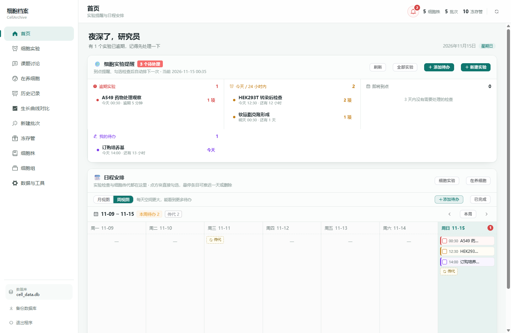

在日历上可以直接操作：

- 点待办前面的**方框** = 勾选完成
- 点**文字** = 打开详情
- 鼠标移到待办上，右侧出现 **`›`**（推迟一天）和 **`×`**（删除）
- **点格子空白处** = 直接输入内容，回车就建成待办

### 细胞实验

新建实验时填：实验名、细胞与条件、实验时间、操作间隔。

系统按「实验时间 + 间隔」自动排出第一次检查时间。间隔可以按小时（12h / 24h / 48h）或按天（1d / 2d / 3d）。

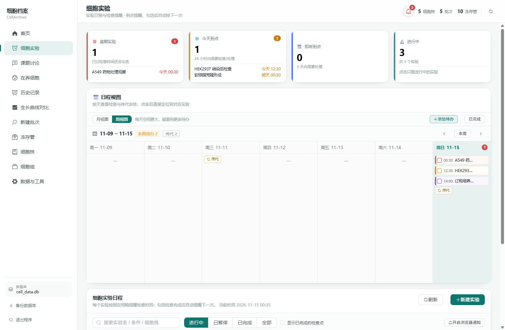

点任意实验打开详情：

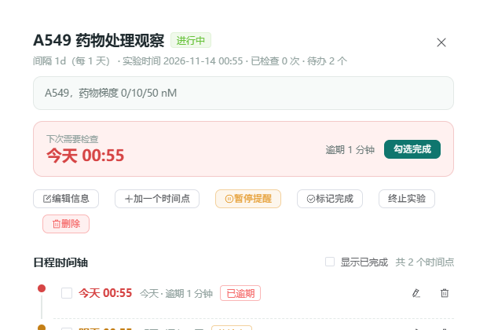

#### 勾选完成

到了检查时间，点「勾选完成」会弹出这个窗口：

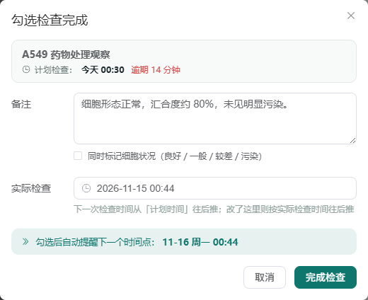

窗口里能看到和处理这些：

| 项目 | 说明 |
| --- | --- |
| 计划检查时间 | 顶部显示这次该检查的时间；已过期会标红「逾期 N 分钟」 |
| **备注** | 可选。记录细胞状态、实验现象，比如「汇合度约 80%，未见污染」 |
| 同时标记细胞状况 | 默认不勾。需要分类记录时勾上，可选良好 / 一般 / 较差 / 污染 |
| **实际检查** | 默认填当前时间。如果你**提前或延后**做了检查，可以改成真实时间 |
| 自动提醒下一个时间点 | 底部实时显示勾选后下一次检查是什么时候 |

点「完成检查」之后：

- 这个时间点变成已完成，时间轴上打勾并记录备注
- **系统自动排出下一次检查时间**，并立即提示「下次检查：11-16 周一 00:43」
- 首页提醒栏、日历、顶栏提醒铃同步刷新

> **关于实际检查时间**：改成真实时间后，系统会按这个时间往后推算下一次，并在时间轴上显示「实际间隔 22 小时」「提前 2 小时」这类记录，方便回头核对实验节奏。

> **手动加的时间点是一次性的**，勾完不会往后排。只有按间隔排出的检查点才会自动接下一次。

### 课题讨论

左边是课题列表，右边是讨论记录。

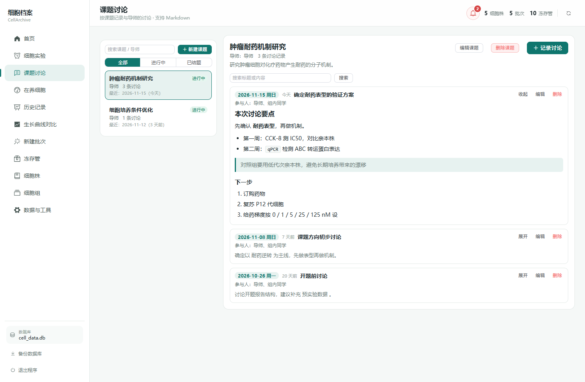

新建课题后点「记录讨论」写内容。**讨论日期默认是今天**，也可以改成以前的日期。内容支持 Markdown，可切换编辑和预览：

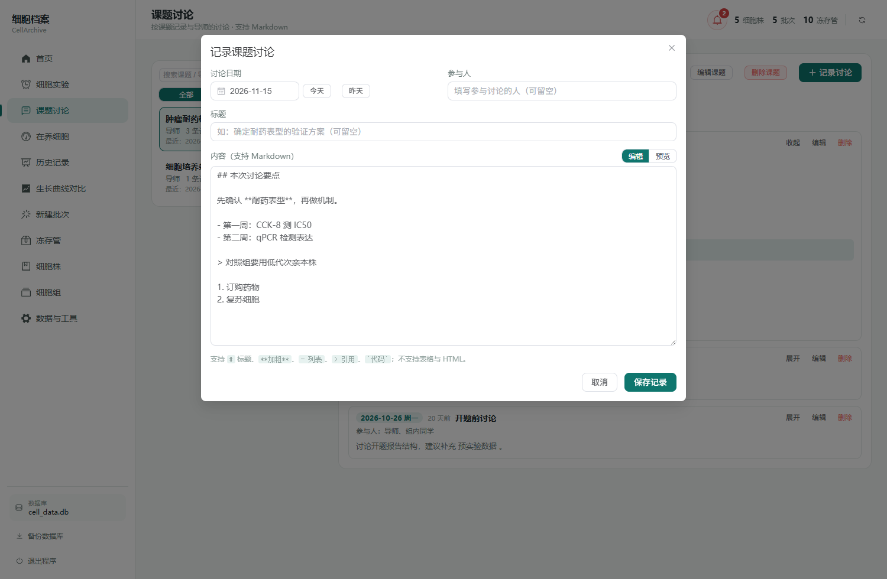

支持的写法：`# 标题`、`**加粗**`、`*斜体*`、`` `行内代码` ``、`- 无序列表`、`1. 有序列表`、`> 引用`、`[链接](url)`。不支持表格和 HTML。

### 在养细胞

顶部四张卡片：在养细胞株、待处理实验、需要传代、待录入位置。后三张点击可跳转。

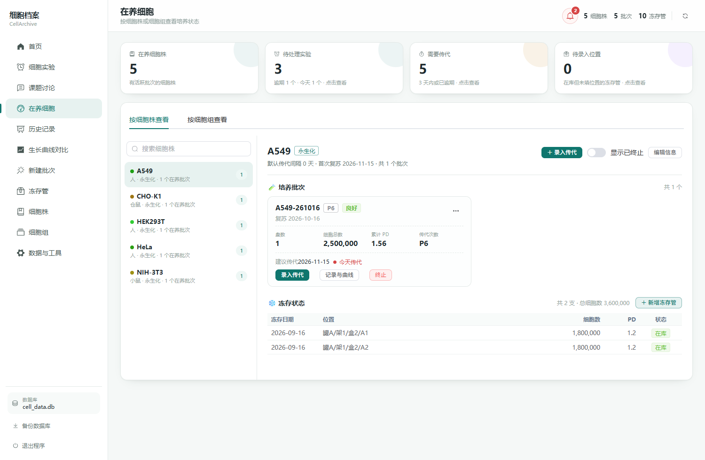

切换到「按细胞组查看」可以看到组内批次汇总、增速对比和组内生长曲线：

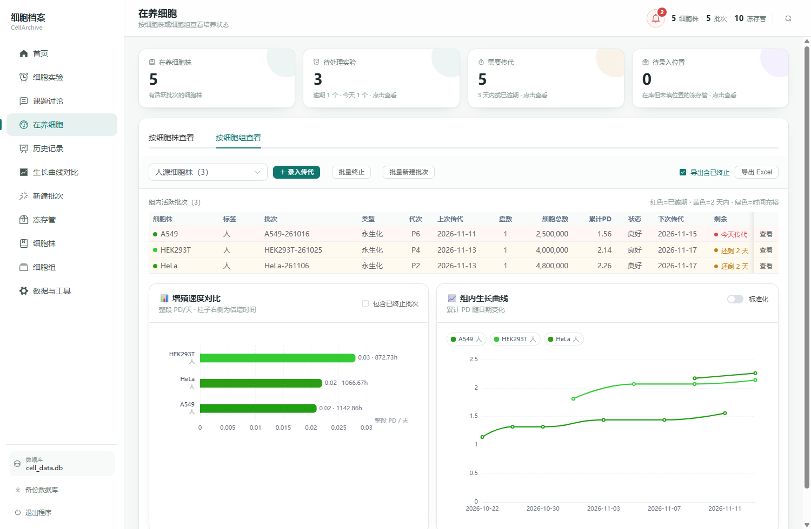

### 传代记录与生长曲线

录入收获细胞数和接种细胞数后，自动计算单次 PD、累计 PD、PD/天和倍增时间。所有记录可以在「历史记录」页查看和修改。

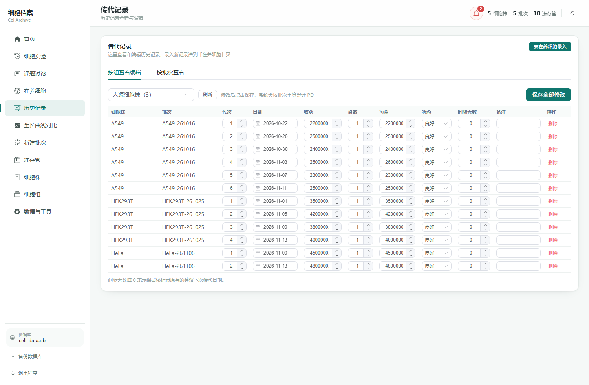

生长曲线支持两种看法：原始累计 PD，或标准化成扩增倍数（2^ΔPD）后用对数轴比较不同起点的批次。

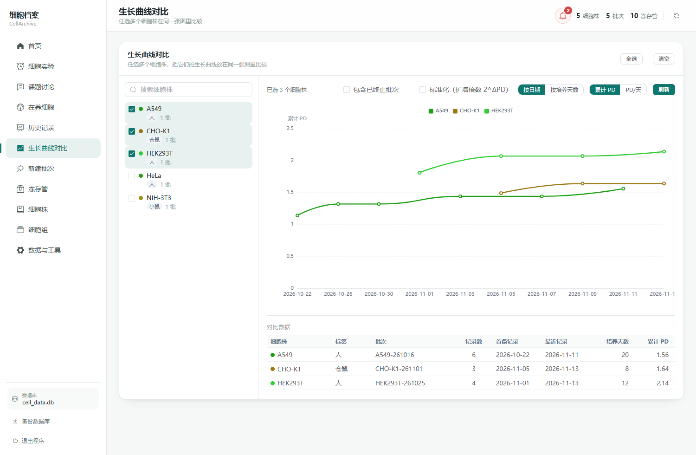

### 冻存管理

9×9 冻存盒视图，点空孔位直接录入，点已有孔位看详情。位置按 `罐A/架1/盒1/A1` 格式填写，系统自动生成对应盒子。

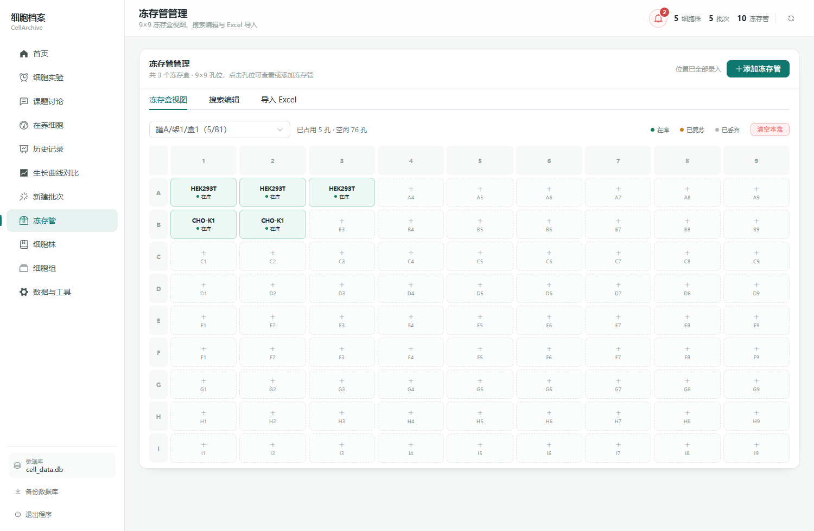

也支持 Excel 批量导入：每个 Sheet 代表一个盒子，在 A1:I9 区域填细胞名、细胞数、PD、日期等。

### 细胞株与标签

标签是自由文本，填物种、细胞类型、项目代号都可以。同一标签用同一色系，不同标签明显区分，颜色只由标签名决定。

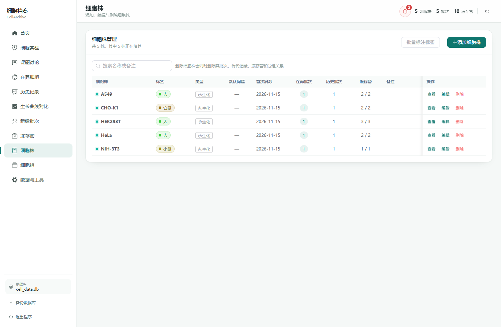

### 数据与工具

备份恢复、数据体检、认证设置都在这里。

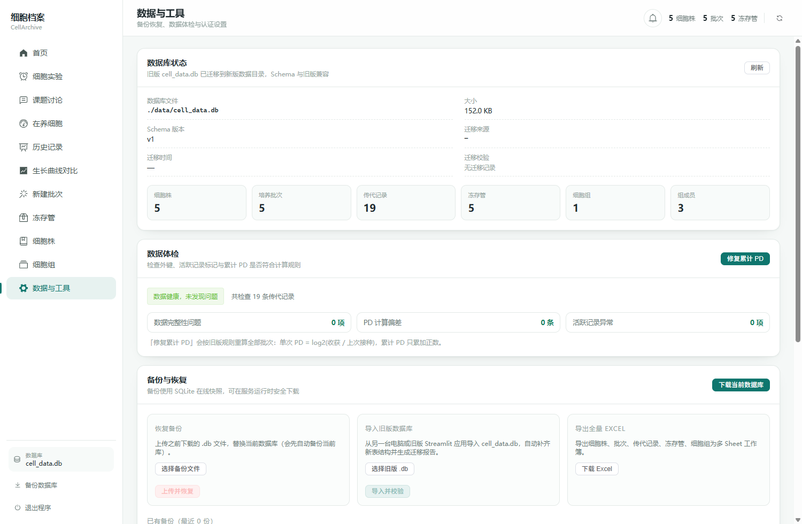

数据存在一个 SQLite 文件里。程序只监听本机 `127.0.0.1`，不会向任何服务器发送数据。

---

## 配置（可选）

默认不用配置。只有想改端口、开放局域网、开启登录时，才需要复制 `config.example.json` 为 `config.json`：

| 字段 | 说明 |
| --- | --- |
| `host` | `127.0.0.1` 只有本机可访问；改成 `0.0.0.0` 后局域网其他设备也能访问 |
| `port` | 端口，默认 18600。被占用时改成 18601 等 |
| `database` | 数据库位置，默认 `data/cell_data.db` |
| `auth.enabled` | 是否启用登录，默认关闭 |

---

## 常见问题

<details>
<summary><b>提示「未找到 Python 3.10 或更高版本」</b></summary>

Python 没装好或版本太旧。重装时勾选 **Add python.exe to PATH**，装完关掉命令行窗口再试。
</details>

<details>
<summary><b>提示「未找到 Node.js / npm」</b></summary>

去 <https://nodejs.org/zh-cn> 装 LTS 版本，装完关掉命令行窗口，重新双击 `start.bat`。
</details>

<details>
<summary><b>Mac 双击没反应</b></summary>

右键点文件 → **打开**，弹窗里再点一次**打开**。还不行就在终端执行 `chmod +x start.command`。
</details>

<details>
<summary><b>页面打不开</b></summary>

先确认命令行窗口还开着，然后手动访问 <http://127.0.0.1:18600/>。改过端口的话用你配置里的端口号。
</details>

<details>
<summary><b>提示端口已被占用</b></summary>

改 `config.json` 里的 `port`（比如 18601），或关掉占用该端口的程序。
</details>

<details>
<summary><b>页面没更新</b></summary>

进入 `frontend` 目录执行 `npm run build` 重新构建，然后按 **Ctrl + F5**（Mac 按 **Cmd + Shift + R**）强制刷新。
</details>

<details>
<summary><b>数据会不会传到网上</b></summary>

不会。程序只在本机运行，不向任何服务器发送数据。除非你把 `host` 改成 `0.0.0.0` 主动开放局域网。
</details>

---

## 关于 Windows 免安装版

另有一个打包好的 exe 版本，**不需要安装 Python 和 Node.js**，但功能**停留在早期版本**：

> ⚠️ 只有培养管理（细胞株、批次、传代、冻存、生长曲线），**没有细胞实验、待办日程、课题讨论**。这些模块等待后续更新。
>
> 想要完整功能，请用上面的**源码部署**方式。

---

## 许可

见 [LICENSE](LICENSE)。
